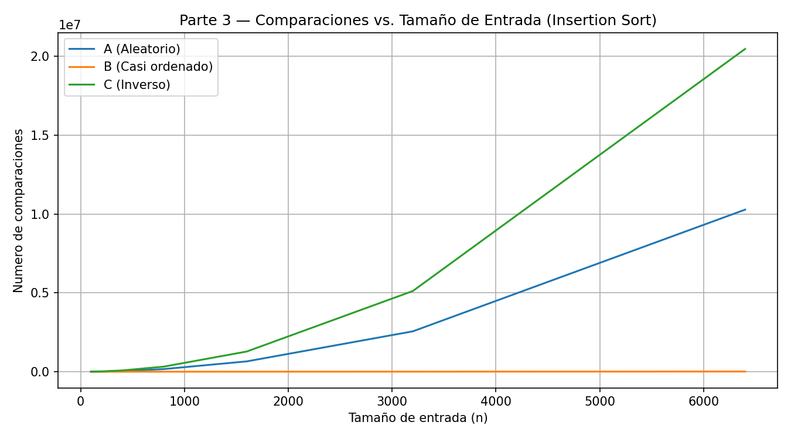
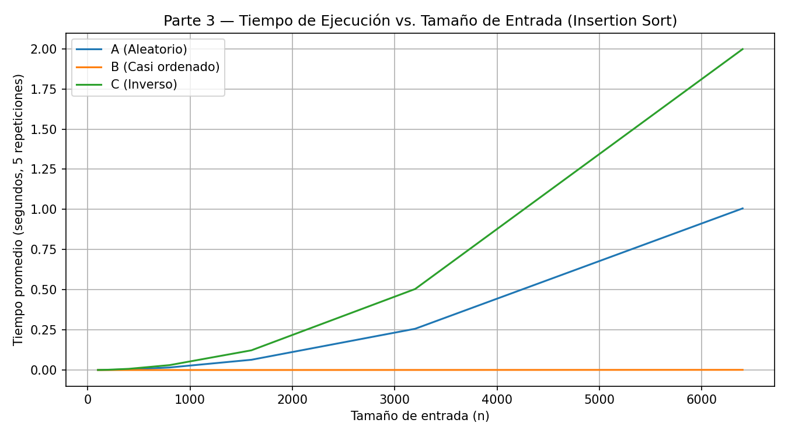
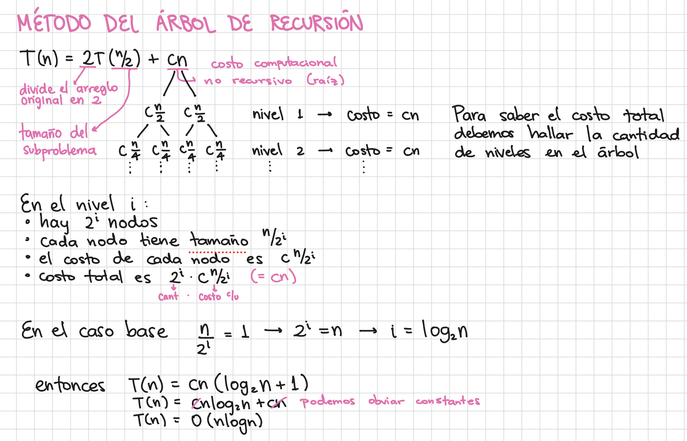
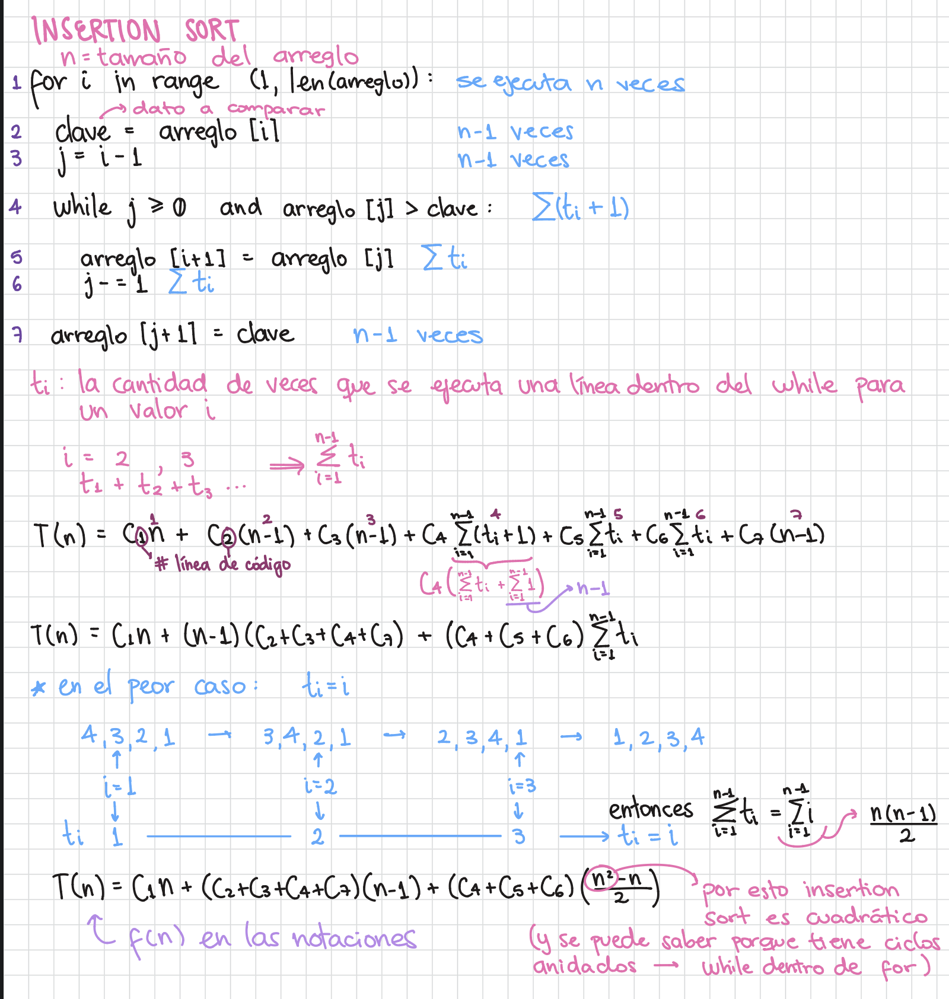
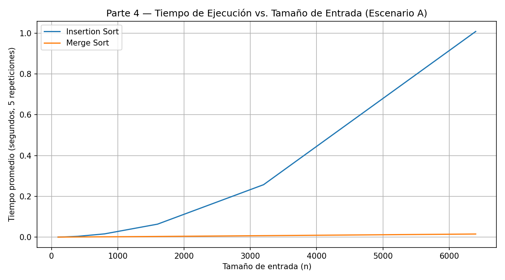

# Laboratorio evaluativo 01 — Fundamentos, complejidad y recurrencias
#### Estudiante: Carla Juliana Giraldo Camacho
---
### Instrucciones para reproducir el experimento:
Para ejecutar los experimentos y regenerar las tablas y gráficas del informe, siga estos pasos desde la terminal de comandos:

#### 1. Clonar el repositorio y ubicarse en su raíz
```bash
git clone https://github.com/carlagiraldo09/CarlaGiraldo_AnalisisDeAlgoritmos.git
cd CarlaGiraldo_AnalisisDeAlgoritmos
```
#### 2. Activar el entorno virtual de Python
El entorno virtual y `requirements.txt` están en la raíz del repositorio, no dentro de la carpeta del laboratorio. Instale las dependencias una vez y active el entorno desde esa raíz:

- Windows
```bash
py -m venv venv
venv\Scripts\activate
pip install -r requirements.txt
cd lab1-fundamentos-complejidad-recurrencias
```

- MacOS/Linux
```bash
python3 -m venv venv
source venv/bin/activate
pip install -r requirements.txt
cd lab1-fundamentos-complejidad-recurrencias
```

#### 3. Ejecución de los scripts por partes
 - Parte 3 — Experimento con Insertion Sort (Escenarios A, B y C)

    Ejecuta el algoritmo de inserción sobre los tres escenarios de datos y genera las gráficas de comparaciones y tiempo
    ```bash
    python parte3_casos.py
    ```
 - Parte 4 — Validación Experimental (Insertion Sort vs. Merge Sort)

    Ejecuta la comparación entre ambos algoritmos sobre el escenario aleatorio y genera la gráfica de comparación de tiempos
    ```bash
    python parte4_complejidad.py
    ```
---
### Parte 1
#### La Secretaría está por firmar la compra de un servidor del doble de velocidad para que el proceso de Tamiza quepa en la ventana de cuatro horas. 
#### ¿Por qué debe analizarse primero el algoritmo, si el que está en producción lleva ocho años entregando el resultado correcto?
La Secretaría de Salud utilizando el software actual Tamiza, cumplen con la corrección: un algoritmo que ordene los casos de mayor a menor riesgo, pero, no cumple con la eficiencia temporal requerida de 4 horas. Es decir, la corrección garantiza el resultado, pero es totalmente aparte de los recursos computacionales y del tiempo necesarios para llegar a este.

La restricción que se incumple es la latencia máxima de ejecución de cuatro horas que nos mencionan tiene el sistema para cumplir su tarea. Y el duplicar la velocidad del servidor no resuelve el problema de fondo debido a que el crecimiento del tiempo de ejecución según la cantidad de datos es cuadrático. Por lo que, a pesar de que sea posible que aliviane (así sea mínimo) el problema, no es una solución que se mantenga a largo plazo. 

Para entenderlo mejor, si se duplica la velocidad se gana, como máximo, un factor 2 en el tiempo. Ese factor fijo es mucho menor que el crecimiento cuadrático del trabajo cuando aumenta la cantidad de registros.

Por ejemplo, un banco que adquiere los clientes de su competencia por compra de la misma (Banco de Bogotá e Itaú). La cantidad de clientes aumenta debido a la migración en aproximadamente 267.000 usuarios, con un promedio de depósitos totales de COP$4,1 billones.

Durante el cierre bancario nocturno, el sistema ejecuta un proceso para validar que no existan transacciones duplicadas o fraudulentas. Entonces, compara cada transacción contra el resto mediante un algoritmo de búsqueda y la restricción del sistema es una ventana de tiempo de 1:00am a 4:00am (3 horas) antes de reabrir las consultas.

Aunque se cumpla la identificación de duplicados y fraudes, comparar un promedio de 1'335.000 de registros más que en el pasado resulta en un incumplimiento de la ventana de tiempo que anteriormente servía. Si el sistema conserva la comparación por pares (un algoritmo cuadrático), una ejecución estimada de seis horas excede las tres horas entre la 1:00 a. m. y las 4:00 a. m.; por tanto, el resultado correcto llega demasiado tarde y deja las consultas indisponibles.

---
### Parte 2
#### Como responsable técnico de Tamiza, ¿qué responsabilidad ambiental y ética asume al decidir qué algoritmo de ordenamiento se ejecuta cada madrugada sobre los datos de 1.200.000 pacientes?

##### Ambiental:
El tiempo de ejecución del algoritmo se traduce en consumo de energía eléctrica y huella de carbono. En el caso del Insertion Sort (que tiene un Big O(n^2)) procesando 1'200.000 registros, el procesador opera al 100 % de su capacidad durante horas, manteniendo la CPU, los sistemas de refrigeración del centro de datos y la memoria RAM en su mayor demanda energética. Lo que significa que puede mantener un servidor encendido y a máxima carga durante 4 a 8 horas todas las madrugadas del año.

A largo plazo la diferencia entre ejecutarlo contra un algoritmo eficiente representa miles de kilovatios-hora desperdiciados. Y el comprar un servidor del doble de potencia para correrlo empeora la situación, ya que duplica el consumo eléctrico y la demanda de refrigeración, incrementando la huella ecológica de la Secretaría de Salud.

##### Ética:
Si el proceso nocturno no concluye a las 6:00am y el centro de contacto recibe una lista incompleta o desordenada, un paciente con un índice de riesgo alto podría quedar fuera o incluso al final de la lista y ser contactado días después. Un retraso de 24 a 48 horas en un tamizaje cardiovascular puede significar la diferencia entre una atención preventiva a tiempo y un evento grave (como un infarto).

Las consecuencias las asume el paciente, su familia, y el sistema de salud público. El paciente debido al riesgo de deterioro de su salud o muerte, y el sistema de salud costeando una atención a futuro mucho más compleja y costosa.

Si el algoritmo falla en la ordenación, no solo incumple en el tiempo, sino que en la equidad del programa. Un ordenamiento incorrecto perjudica el principio médico de atender primero a quien tiene mayor probabilidad de complicarse. Por esto el equipo técnico tiene la obligación ética de garantizar que el código se ejecute dentro de las 4 horas, y a su vez de verificar que la lógica de ordenamiento respete la prioridad del índice de riesgo.

Los costos no se distribuyen de manera abstracta. Primero, el paciente de alto riesgo que queda sin llamada o al final de la lista asume el costo más grave: demora en la valoración, ansiedad y posible deterioro clínico; su familia también carga con esa consecuencia. Segundo, el operador del centro de contacto asume el costo operativo de trabajar con una lista parcial: debe explicar retrasos, rehacer prioridades y recibe presión por una falla que no causó. La Secretaría asume costos institucionales y de atención tardía, y el equipo de desarrollo asume la responsabilidad profesional de corregir y vigilar el proceso. Identificar estos responsables obliga a no trasladar el riesgo de una mala decisión técnica a pacientes u operadores.

----
### Enlaces directos a código
[Código de los algoritmos de ordenamiento](algoritmos.py)

[Código de los generadores de lotes para los experimentos](datos.py)

[Código del experimento de la Parte3](parte3_casos.py)

[Código del experimento de la Parte4](parte4_complejidad.py)

----
### Parte 3
#### 3.1 - Peor caso, mejor caso y caso promedio
1. Peor caso:

    Es la situación en la que el algoritmo realiza el **mayor** número de operaciones (comparaciones y desplazamientos) sobre el conjunto de datos con tamaño n. 

    Para Insertion Sort, es cuando la lista original está ordenada en sentido inverso al que se quiere obtener (asc o desc).

2. Mejor caso:

    Es la situación en la que el algoritmo realiza el **menor** número de operaciones (comparaciones y desplazamientos) sobre el conjunto de datos con tamaño n. 

    Para Insertion Sort, es cuando la lista original está ordenada en el sentido al que se quiere llegar. En este caso, el algoritmo solo hace comparaciones y no desplazamientos.

3. Caso promedio:

    Es la situación en la que el algoritmo realiza una cantidad **promedio** de operaciones (comparaciones y desplazamientos) sobre el conjunto de datos con tamaño n. 

    Para Insertion Sort, es cuando el orden de la lista de entrada es completamente aleatorio.

En las tres definiciones se mantiene fijo el tamaño `n` y se considera el conjunto de todas las listas posibles de `n` índices distintos. El peor caso es el máximo costo de insertion sort dentro de ese conjunto; el mejor caso es el mínimo; y el caso promedio es la media del costo al considerar todas esas permutaciones como igualmente probables. No son tres tamaños distintos: son tres formas de entrada para el mismo `n`.

##### ¿Cuál de los tres casos usaría para decidir si el algoritmo de Tamiza entra en producción, sabiendo que la ventana de cuatro horas es estricta, y por qué?
Usaría el peor de los casos para realizar las pruebas y decidir si entra en producción, ya que el tiempo de ejecución en el peor caso siempre será el tope máximo que puede alcanzar. Teniendo en cuenta que contamos con una ventana de tiempo estricta para el ordenamiento.

Es decir, si el algortimo es eficiente en el peor caso, entonces también está garantizada su eficiencia en cuaquier otro caso.

##### Predicción de los casos para la situación problema
| Escenario | Predicción | Justificación
|-----|--------|-----
| A - Aleatorio | Caso promedio | Los datos vienen en un oden neutro, sin relación al nivel de riesgo
| B - Casi ordenado | Mejor caso | Es la mayoría de la lista previa (día anterior) que ya está ordenada
| C - Orden inverso | Peor caso | La lista está ordenada al contrario de lo requerido por el centro de contacto (inversa)
#
#### 3.2 — Demostración Experimental de Casos en Insertion Sort
[Código del experimento de la Parte3](parte3_casos.py)

#### Gráficas de Desempeño
| Comparaciones vs. Tamaño (n) | Tiempo de Ejecución vs. Tamaño (n) |
| :---: | :---: |
|  |  |

#### Análisis de resultados y comparación con la predicción
1. Peor Caso (Escenario C — Inverso):

   Presentó la curva cuadrática más pronunciada tanto en número de comparaciones como en tiempo de ejecución.
   
   Coincide con la predicción realizada dado que el lote proviene ordenado de menor a mayor y Tamiza requiere un ordenamiento descendente (de mayor a menor), cada nuevo elemento debe insertarse desplazándose a lo largo de todo el listado ordenado acumulado.

2. Mejor Caso (Escenario B — Casi Ordenado):

   Registró los valores mínimos de tiempo y comparaciones. La curva de crecimiento es casi lineal.
   
   Coincide con la predicción dado que el 98 % del lote ya está ordenado de mayor a menor, el Insertion Sort realiza una sola comparación para cada uno de los elementos y el 2 % restante desordenado al final tiene un uso mínimo que no altera de manera significativa el rendimiento general del caso.

3. Caso Promedio (Escenario A — Aleatorio):

   Se evidencia un comportamiento cuadrático con aproximadamente la mitad de comparaciones e intercambios respecto al Peor Caso.
   
   Coincide con la predicción al no existir una ordenación previa de los datos, la probabilidad de que un elemento se inserte en cualquier posición es constante, requiriendo recorrer en promedio la mitad del listado en cada paso.

### Parte 4
#### 4.1 - Cálculo teórico
##### Árbol de recursión - Merge Sort


##### Cota: Línea a Línea - Insertion Sort


La recurrencia de merge sort es `T(n) = 2T(n/2) + Θ(n)`. Los dos términos `T(n/2)` aparecen porque cada llamada divide el lote en dos mitades; `Θ(n)` es el recorrido necesario para mezclar las dos listas ya ordenadas. Con un árbol de recursión, cada nivel suma `Θ(n)`: en el nivel 0 hay una mezcla de `n`, en el nivel 1 hay dos de `n/2`, en el nivel 2 hay cuatro de `n/4`, y así sucesivamente. El árbol llega a hojas de tamaño 1 después de `log₂ n` divisiones.

```text
n                         costo Θ(n)
├── n/2 + n/2             costo 2·Θ(n/2) = Θ(n)
│   ├── n/4 ...           costo 4·Θ(n/4) = Θ(n)
│   └── ...
└── ...

log₂ n niveles con costo Θ(n) + hojas Θ(n)
T(n) = Θ(n)·log₂ n + Θ(n) = Θ(n log n)
```

En `insertion_sort`, la copia de la lista cuesta `Θ(n)`. El `for` se ejecuta `n - 1` veces. En la iteración `i`, `clave` y `posicion` se asignan una vez; el `while` hace una comparación entre elementos por cada posición que debe revisar. En el peor caso revisa `i` elementos y desplaza `i` posiciones; el total de comparaciones es `Σ(i=1..n-1) i = n(n-1)/2`, por lo que el costo es `Θ(n²)`. En el mejor caso, la primera comparación falla en cada iteración: hay `n - 1` comparaciones y costo `Θ(n)`. Con una permutación aleatoria, cada clave recorre en promedio cerca de la mitad de la sección ordenada; la suma es aproximadamente `n(n-1)/4`, así que el caso promedio también es `Θ(n²)`.

| Algoritmo | Mejor caso | Caso promedio | Peor caso |
|---|---:|---:|---:|
| Insertion sort | Θ(n) | Θ(n²) | Θ(n²) |
| Merge sort | Θ(n log n) | Θ(n log n) | Θ(n log n) |
#
#### 4.2 - Validación experimental
[Código del experimento de la Parte4](parte4_complejidad.py)
##### Gráfica Comparativa de Tiempo de Ejecución


##### Análisis de resultados y conclusiones
A partir de la gráfica `parte4_tiempo.png`, Merge Sort es el algoritmo recomendado para Tamiza. Las mediciones son el promedio de cinco ejecuciones por tamaño, para reducir el efecto de variaciones puntuales del equipo.

Insertion Sort muestra una parábola que se acelera rápidamente a medida que aumenta el tamaño de la entrada. Para muestras pequeñas, el tiempo de procesamiento es casi imperceptible, pero al llegar a 6.400 registros el tiempo crece demasiado. 

Proyectar esta curva hacia la carga real de 1.200.000 registros confirma que el sistema desbordaría de forma crítica la ventana operacional de 4 horas (2:00am a 6:00am).

A diferencia, Merge Sort mantiene un perfil casi plano en la parte inferior de la gráfica, incluso para el tamaño máximo probado de 6.400, el algoritmo resuelve el ordenamiento en una fracción mínima de segundo, demostrando escalabilidad para procesar grandes volúmenes de datos.

Los resultados obtenidos en la gráfica coinciden con las complejidades asintóticas calculadas teóricamente:

* Merge Sort $\Theta(n \log n)$:

    Permite reducir drásticamente el número de comparaciones e intercambios requeridos para ordenar la lista respecto a un bucle anidado.
* Insertion Sort $\Theta(n^2)$:

    La presencia de ciclos anidados (while dentro del ciclo for) hace que la cantidad de operaciones crezca de forma cuadrática en el caso promedio (Escenario A).

En la gráfica se observa que para cantidades muy pequeñas de datos la diferencia de tiempo entre ambos algoritmos es casi imperceptible. Pero, a partir de 400, el costo algorítmico $\Theta(n \log n)$ muestra ventaja.
#
#### 4.3 - Concepto Técnico a la Secretaría de Salud
Sobre el funcionamiento del sistema Tamiza y responder a la propuesta de comprar un nuevo servidor, y entendiendo que el equipo no quiere complicarse manteniendo tres códigos diferentes según cómo lleguen los datos, nuestra recomendación clara y directa es reemplazar el algoritmo actual (Insertion Sort) por Merge Sort. El algoritmo actual solo funciona rápido cuando los datos ya vienen casi ordenados; si por algún cambio en el flujo los datos llegan desordenados o al revés, el sistema se vuelve extremadamente lento. En cambio, Merge Sort  sin importar cómo lleguen los datos garantiza que el proceso siempre sea rápido y confiable.

Para que tengan una dimensión del problema con datos reales, hicimos una proyección basada en pruebas de laboratorio. (Estos números son una estimación matemática calculada a partir de nuestras mediciones y no una prueba directa sobre el total de pacientes). 

En la gráfica `graficas/parte4_tiempo.png`, el punto de 6.400 registros muestra un promedio de 1,008 segundos para insertion sort y 0,015 segundos para merge sort. Extrapolar el promedio aleatorio de insertion sort con el factor cuadrático `(1.200.000 / 6.400)²` da aproximadamente 9,8 horas. Para merge sort, al escalar por `n log₂ n`, la estimación es aproximadamente 4,5 segundos. Estas cifras son estimaciones basadas en las mediciones, no una medición directa de 1.200.000 pacientes.

Por esta razón, no recomendamos comprar el servidor del doble de velocidad como sustituto del cambio de algoritmo. Tomando el dato medido de 1,008 segundos en `parte4_tiempo.png` para `n = 6.400`, duplicar la velocidad solo reduce la estimación aleatoria de 9,8 a cerca de 4,9 horas: aún incumple la ventana de cuatro horas. Además, en `parte3_tiempo.png` el escenario inverso tardó 1,998 segundos para ese mismo tamaño, casi el doble del aleatorio; por tanto, el servidor nuevo seguiría expuesto al canal de entrada más adverso. El hardware puede acompañar la mejora, pero no corrige la causa cuadrática.

Por último, queremos darles tranquilidad sobre el uso de memoria RAM de Merge Sort. Aunque este algoritmo necesita un poco de memoria extra para hacer las mezclas de datos, procesar los 1.200.000 registros solo consumirá una cantidad minúscula que cualquier servidor actual soporta sin problemas. Además, Merge Sort respeta el orden de llegada de los pacientes que tengan el mismo nivel de riesgo, asegurando un trato justo para todos.
