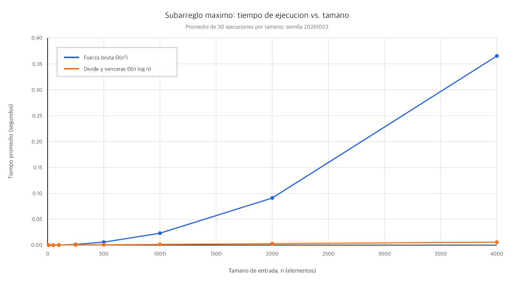

# Laboratorio evaluativo 02 — Dividir y vencer

#### Estudiante: Carla Juliana Giraldo Camacho

---

### Instrucciones para reproducir el experimento

Desde la raíz del repositorio, cree y active el entorno virtual e instale las dependencias. Después ingrese a la carpeta del laboratorio.

```bash
python3 -m venv venv
source venv/bin/activate
pip install -r requirements.txt
cd lab2-divide-y-vencer
```

En Windows, la activación es `venv\Scripts\activate`. Para comprobar las soluciones ejecute:

```bash
python pruebas.py
```

Para repetir las mediciones y regenerar la gráfica ejecute:

```bash
python medicion.py
```

---

## Parte 1 — Implementar y verificar

[Ver `subarreglo.py`](subarreglo.py) · [Ver `pruebas.py`](pruebas.py)

Implementé dos formas de buscar la mejor racha de variaciones consecutivas. La primera conserva una suma acumulada para cada día inicial y revisa todos los finales posibles. La segunda divide el rango en dos mitades, resuelve cada mitad y compara esos resultados con la mejor racha que atraviesa el punto medio.

Las pruebas cubren la serie propuesta de ocho días, una lista de un elemento, listas solo negativas y solo positivas, una racha óptima que cruza el medio y 25 listas aleatorias. En las listas aleatorias se compara la suma devuelta por ambas soluciones; no se exigen índices iguales porque pueden existir empates válidos.

## Parte 2 — Medir y graficar

[Ver `medicion.py`](medicion.py)

La gráfica se obtuvo con listas reproducibles de enteros entre -100 y 100, usando la semilla fija `20261003`. Para cada tamaño usé exactamente la misma lista en ambas funciones, comprobé que devolvieran la misma suma y promedié 30 ejecuciones. El cronómetro rodea únicamente la llamada del algoritmo; la generación de datos queda fuera de la medición.

| n | Fuerza bruta (s) | Divide y vencerás (s) |
|---:|---:|---:|
| 10 | 0,0000040 | 0,0000099 |
| 50 | 0,0000575 | 0,0000514 |
| 100 | 0,0002178 | 0,0001086 |
| 250 | 0,0012944 | 0,0002819 |
| 500 | 0,0056941 | 0,0006293 |
| 1000 | 0,0229326 | 0,0013290 |
| 2000 | 0,0909643 | 0,0027162 |
| 4000 | 0,3653715 | 0,0057797 |



## Parte 3 — Análisis

### 1. Recurrencia y complejidad

Para `subarreglo_maximo`, una llamada de tamaño `n` crea dos subproblemas de aproximadamente `n/2`: uno para la mitad izquierda y otro para la derecha. Además, calcula el caso que atraviesa el punto medio. Ese cálculo recorre una vez la mitad izquierda hacia atrás y una vez la derecha hacia adelante; entre los dos recorridos cuesta Θ(n). Por tanto, la recurrencia es `T(n) = 2T(n/2) + Θ(n)`, con caso base de un elemento.

En el método maestro, `a = 2`, `b = 2` y `f(n) = Θ(n)`. Entonces `n^(log_b a) = n^(log₂ 2) = n`, por lo que la comparación completa es `f(n) = Θ(n) = Θ(n^(log_b a))`. Corresponde al caso 2 y el resultado es Θ(n log n).

La fuerza bruta acumulada no vuelve a sumar desde cero cada tramo. Para cada índice inicial recorre los finales posibles y actualiza una suma, lo que forma aproximadamente `n(n + 1) / 2` iteraciones. Esa cantidad es Θ(n²).

### 2. Lo medido frente a lo esperado

Para evitar apoyar la conclusión en un solo par, comparé los tres últimos intervalos en los que `n` se duplica:

| Cambio de n | Factor fuerza bruta | Factor divide y vencerás | Factor teórico n log₂ n |
|---|---:|---:|---:|
| 500 → 1000 | 4,03 | 2,11 | 2,22 |
| 1000 → 2000 | 3,97 | 2,04 | 2,20 |
| 2000 → 4000 | 4,02 | 2,13 | 2,18 |

La fuerza bruta se aproxima repetidamente al factor 4 esperado al duplicar una entrada Θ(n²). Divide y vencerás crece alrededor de un factor 2 y queda cerca de los factores entre 2,18 y 2,22 previstos para Θ(n log n). Las diferencias pequeñas son coherentes con el ruido del temporizador, la carga del equipo y el costo fijo de las llamadas.

### 3. Tamaños pequeños

El primer tamaño medido en el que divide y vencerás gana es `n = 50`: fuerza bruta tarda 57,5 µs y divide y vencerás 51,4 µs. La diferencia de unos 6 µs es pequeña y el punto de cruce puede variar entre equipos. En `n = 10`, fuerza bruta todavía gana (4,0 µs frente a 9,9 µs); en `n = 100`, la ventaja recursiva ya es clara (108,6 µs frente a 217,8 µs). Estos datos muestran que la recursión tiene un costo fijo apreciable en entradas pequeñas, pero el crecimiento cuadrático termina dominando.

### 4. ¿Cuándo conviene dividir?

Para hallar solo el máximo de un arreglo no conviene dividir si ya existe un recorrido simple. La versión recursiva tendría `T(n) = 2T(n/2) + Θ(1)`: resuelve dos mitades y compara sus dos máximos con costo constante. Por método maestro es Θ(n), igual que recorrer una vez el arreglo. No reduce el orden de crecimiento y añade llamadas recursivas, por lo que en este caso la pasada iterativa suele ser preferible. Dividir ayuda cuando la combinación evita una alternativa peor, como sucede aquí al tratar explícitamente el tramo cruzado.

### 5. Concepto para la gerente

Recomiendo divide y vencerás para las series grandes de la cooperativa. Conserva la misma respuesta que fuerza bruta, pero su crecimiento es Θ(n log n), mientras que fuerza bruta crece como Θ(n²). Para una serie de 1.000.000 de registros, la estimación parte del punto medido en `n = 4000`, no de una regla de tres lineal. Fuerza bruta se escala por `(1.000.000 / 4000)² = 62.500`: `0,3653715 × 62.500` da cerca de 22.836 s, o 6,34 horas. Divide y vencerás se escala por `(1.000.000 log₂ 1.000.000) / (4000 log₂ 4000) = 416,43`; `0,0057797 × 416,43` estima unos 2,41 s. Son estimaciones: el hardware, la memoria y el intérprete pueden modificar el tiempo real, pero la diferencia de crecimiento explica por qué conviene la solución recursiva para cientos de miles o millones de registros.
