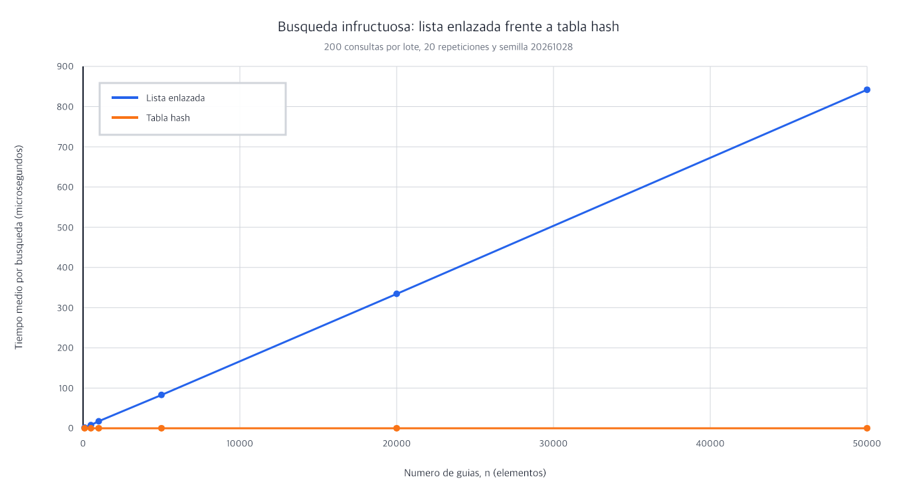
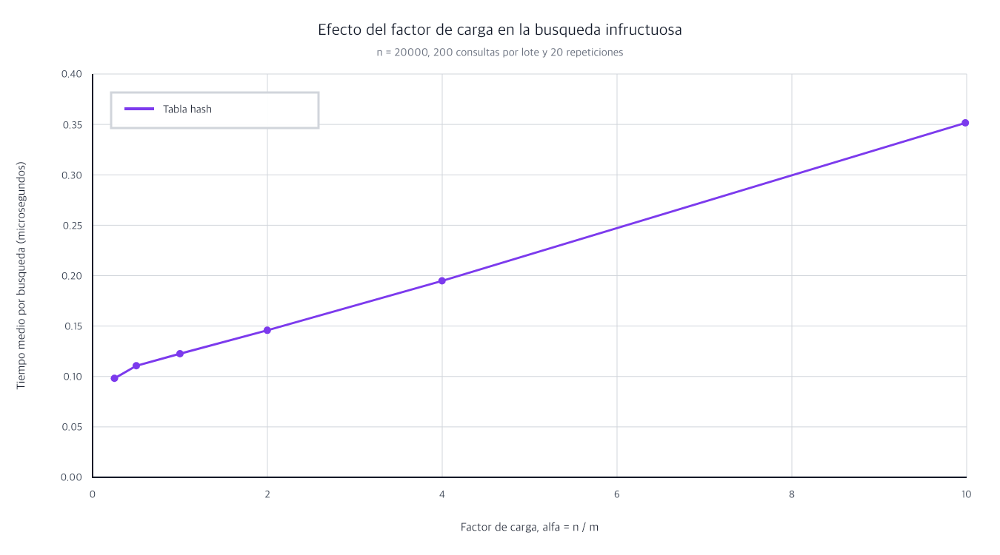

# Laboratorio evaluativo 03 — Estructuras de datos

**Estudiante:** Carla Juliana Giraldo Camacho

## Reproducción

Desde la raíz del repositorio se crea y activa el entorno, se instalan las
dependencias y se entra a la carpeta del laboratorio:

```bash
python3 -m venv venv
source venv/bin/activate
pip install -r requirements.txt
cd lab3-estructuras-datos
```

En Windows, la activación se hace con `venv\Scripts\activate`. Las pruebas y
las mediciones se ejecutan, respectivamente, con:

```bash
python pruebas.py
python medicion.py
```

## Parte 1 — Implementación y verificación

Código: [estructuras.py](estructuras.py) y [pruebas.py](pruebas.py).

Implementé la lista enlazada con inserción al inicio y búsqueda iterativa. La
tabla hash usa el método de la división y resuelve las colisiones mediante
encadenamiento: cada casilla reutiliza una `ListaEnlazada`.

Las pruebas cubren búsquedas exitosas e infructuosas, una estructura vacía,
tamaños y factor de carga. También fuerzan la colisión de 10, 24 y 17 en la
casilla 3 de una tabla con siete casillas. Además de los casos mínimos, comparé
las dos estructuras en 50 colecciones aleatorias reproducibles; en cada una
probé todas las guías existentes y diez inexistentes.

## Parte 2 — Medición y gráficas

Código: [medicion.py](medicion.py).

Usé la semilla fija 20261028 y los mismos datos en ambas estructuras. Para cada
punto medí 200 búsquedas infructuosas, repetí el lote 20 veces y calculé el
promedio de 4.000 consultas. La construcción y la generación de datos quedaron
fuera del cronómetro. Antes de medir verifiqué 20 guías existentes. En el primer
experimento escogí valores primos de `m` cercanos a `n / 2`.

### Lista enlazada frente a tabla hash



| n | m | α | Lista (µs) | Tabla (µs) |
|---:|---:|---:|---:|---:|
| 100 | 53 | 1,8868 | 1,7037 | 0,1304 |
| 500 | 251 | 1,9920 | 7,9863 | 0,1380 |
| 1.000 | 503 | 1,9881 | 17,4143 | 0,1489 |
| 5.000 | 2.503 | 1,9976 | 82,8395 | 0,1516 |
| 20.000 | 10.007 | 1,9986 | 334,3565 | 0,1619 |
| 50.000 | 25.013 | 1,9990 | 841,9562 | 0,1536 |

### Efecto del factor de carga



| α real | m | Tabla (µs) |
|---:|---:|---:|
| 0,2499 | 80.021 | 0,0981 |
| 0,4999 | 40.009 | 0,1106 |
| 0,9995 | 20.011 | 0,1226 |
| 1,9986 | 10.007 | 0,1458 |
| 3,9976 | 5.003 | 0,1948 |
| 9,9850 | 2.003 | 0,3515 |

## Parte 3 — Análisis

### 1. Costo teórico

En una búsqueda infructuosa, la lista no puede detenerse antes: debe comparar
la guía con los `n` nodos para comprobar que no está. Por eso cuesta Θ(n). La
tabla calcula primero una casilla en Θ(1) y recorre únicamente su cadena. Si las
claves se distribuyen uniformemente, la longitud promedio de una cadena es
`α = n / m`; de ahí el costo esperado Θ(1 + α). Este resultado supone hash
uniforme, es decir, que cada clave tiene una probabilidad semejante de caer en
cualquier casilla. Si todas cayeran en una sola, esa cadena tendría `n` nodos y
la tabla volvería a costar Θ(n).

### 2. Lo medido contra lo esperado

De 500 a 1.000 guías, `n` se duplicó: la lista pasó de 7,9863 a 17,4143 µs,
un factor 2,18, mientras la tabla cambió por un factor 1,08. De 5.000 a 20.000,
`n` se cuadruplicó y la lista aumentó 4,04 veces; la tabla, solo 1,07. De 20.000
a 50.000, el tamaño aumentó 2,5 veces: la lista creció 2,52 y la tabla tuvo un
factor 0,95, una pequeña variación de medición. La tendencia corresponde a
Θ(n) para la lista y a tiempo esperado constante cuando α permanece cerca de 2.

En la segunda gráfica, al subir α de 0,2499 a 9,9850, el tiempo pasó de 0,0981
a 0,3515 µs, un factor 3,58. No tiene que multiplicarse exactamente como α,
porque Θ(1 + α) incluye el cálculo de la casilla y otros costos constantes, pero
el aumento sostenido es coherente con cadenas cada vez más largas.

### 3. Colisiones

Hay colisión cuando claves diferentes producen el mismo índice. Puede ocurrir
aunque sobren casillas porque muchas guías posibles se reducen a solo `m`
índices. Con `m = 7`, 10, 24 y 17 dejan residuo 3, por lo que comparten casilla.
El encadenamiento guarda allí una lista: admite cualquier α y su implementación
es directa, a cambio de nodos adicionales y de recorrer la cadena. El
direccionamiento abierto conserva todos los datos dentro del arreglo y busca
otra posición siguiendo una secuencia; aprovecha mejor la memoria contigua,
pero requiere α menor que 1, empeora al llenarse y borrar necesita un marcador
especial para no romper futuras búsquedas.

### 4. Tabla hash o árbol de búsqueda

La tabla no conserva orden: para obtener guías entre X y Y tendría que revisar
las `n`, por lo que esa consulta cuesta Θ(n). En un árbol de búsqueda binario,
las claves menores quedan a la izquierda y las mayores a la derecha. Así se
puede llegar al inicio del rango y recorrer en orden solo la zona necesaria, con
costo Θ(h + k), donde `h` es la altura y `k` la cantidad de resultados.

Si las 400.000 guías ordenadas se insertaran una a una, un árbol común se
convertiría en una cadena: tendría altura aproximada de 399.999 aristas y una
búsqueda podría hacer cerca de 400.000 comparaciones. Construirlo así sumaría
aproximadamente 79.999.800.000 comparaciones. Un árbol equilibrado tendría
alrededor de 19 niveles y una búsqueda necesitaría cerca de 19 comparaciones.

### 5. Concepto para la jefa de operaciones

Recomiendo mantener dos índices: una tabla hash para la consulta puntual del
call center y un árbol de búsqueda equilibrado para los rangos del supervisor.
Esto usa más memoria y obliga a actualizar ambas estructuras cuando cambia un
envío, pero cada necesidad queda respaldada por la estructura apropiada.

La siguiente es una **estimación**, no una medición de cinco millones. Con
50.000 guías, la lista tardó 841,9562 µs. Como su curva es lineal, aumentar el
tamaño cien veces permite estimar `841,9562 × 100 = 84.195,62 µs`, unos 84,20
ms por búsqueda infructuosa. La tabla tardó 0,1536 µs con α cercano a 2; si `m`
crece junto con `n` para conservar ese factor de carga, su costo esperado sigue
siendo Θ(1 + α), así que estimo un valor del mismo orden, cerca de 0,15 µs. Si
se dejaran fijas las casillas, α crecería y esa estimación ya no sería válida.
